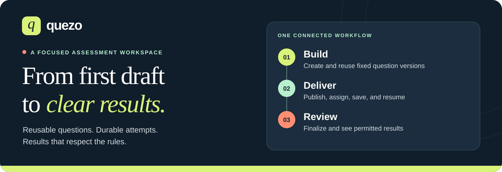
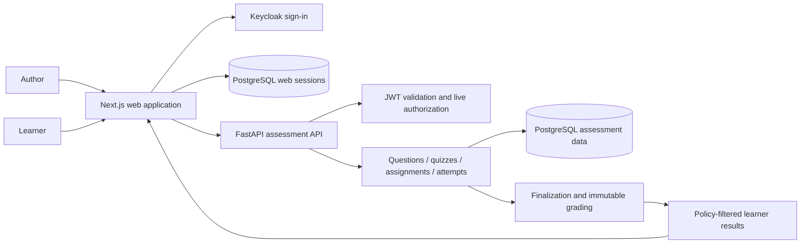

<p align="center">
  
</p>

<h1 align="center">Quezo</h1>

<p align="center">
  <strong>A focused workspace for creating, delivering, and reviewing quizzes.</strong>
</p>

<p align="center">
  Build reusable questions, publish fixed quiz versions, and help learners complete
  assigned assessments with durable saves and policy-aware results.
</p>

<p align="center">
  
  
  
  
  
</p>

<p align="center">
  <a href="#why-quezo">Why Quezo</a> &middot;
  <a href="#the-assessment-workflow">Workflow</a> &middot;
  <a href="#get-started">Get started</a> &middot;
  <a href="#documentation">Documentation</a> &middot;
  <a href="#development-status">Development status</a>
</p>

---

## Why Quezo

A quiz is more than a list of questions. Authors need to know exactly what they
published. Learners need to trust that their answers were saved. Results need to
respect the rules set for the assessment.

Quezo connects those steps in one standalone workspace, without trying to become
a full learning management system.

| What matters | How Quezo supports it |
| --- | --- |
| Reuse without rewriting history | Question banks hold reusable multiple-choice and true/false items with fixed revisions. |
| Publish with confidence | Compose and preview a quiz from exact question versions, then publish an immutable version. |
| Know who can participate | Assign published quizzes to named learners with role-based access. |
| Keep work across interruptions | Save, clear, and resume responses with visible save and conflict/retry states. |
| Keep completion consistent | Finalize an attempt once and score its frozen question and answer definitions. |
| Reveal only permitted results | Apply separate release rules for scores, answer keys, and explanatory feedback. |

**Current release: a single-organization, low-stakes prototype for synthetic data.**
The initial author-to-result lifecycle is accepted. Full P0 coverage,
accessibility, operational readiness, and pilot approval remain open. This is
not a production-ready service or a high-stakes exam platform.

## The assessment workflow

1. **Build a question bank.** Create single-answer multiple-choice or true/false
   questions, including points, correct answers, and explanatory feedback.
   Later edits create new revisions rather than changing existing ones.
2. **Compose and preview.** Select exact question versions, set points, and
   inspect a learner-shaped preview before publishing.
3. **Publish and assign.** Freeze the quiz composition and assign that published
   version to named learners.
4. **Complete an attempt.** Learners open **My assignments**, start an assigned
   quiz, navigate questions, and save or explicitly clear answers. They can
   return to the same attempt and resume saved work.
5. **Submit and see permitted results.** Finalization ends editing and produces
   an immutable grade. The learner result page shows only what the release
   policy allows.

The initial UI uses **untimed quizzes, one successful start per assignment, and
authored question/option order**. Authors choose either **score after
finalization** or **fully withheld results**; both presets withhold answer keys
and explanations. The backend supports additional policy cases, but advanced
timing, availability, ordering, and release controls are not yet accepted UI
features. See the [demo defaults](docs/SOFTWARE-SPECIFICATION.md#phase-2-assignment-and-demo-defaults)
and [repeatable browser walkthrough](tests/e2e/README.md).

## Get started

Quezo runs as a Next.js web application and a separate Python/FastAPI API, backed
by PostgreSQL and Keycloak. Local setup requires explicit database and identity
provisioning; installing packages alone is not enough.

### Prerequisites

- **Node.js 22+ and npm 10+**; `.nvmrc` selects Node 22.
- **Python 3.12+ and [uv 0.12.17](https://docs.astral.sh/uv/getting-started/installation/)**.
- **PostgreSQL and Keycloak** configured using the development guide.
  Docker with Compose supplies optional local dependency services, not
  containers for the application itself.

Commands below run from the repository root and work in PowerShell.

### Install

```powershell
npm ci
uv sync --directory postgres --locked
```

### Configure before starting

Follow the [development setup guide](docs/DEVELOPMENT.md) in this order:

1. [Provision PostgreSQL roles and run migrations](docs/DEVELOPMENT.md#local-database-and-optional-identity-dependency)
   using separate migration and restricted runtime identities.
2. [Configure web sessions and OIDC](docs/DEVELOPMENT.md#configuration-lifecycle-and-oidc-requirements),
   including the web database, issuer, client, and callback settings.
3. [Configure backend identity validation](docs/DEVELOPMENT.md#configuration-and-validation)
   and explicitly [provision the local synthetic Keycloak realm/accounts](infra/keycloak/README.md).

Use [.env.example](.env.example) as a configuration reference and follow the
guide's process-specific environment instructions. Both application processes
require PostgreSQL. Signing in does not automatically grant application access.
Never commit credentials or use real learner data for the prototype.

### Run

Start the web application:

```powershell
npm run dev:web
```

In another terminal, start the API:

```powershell
npm run dev:api
```

Open **[localhost:3000](http://localhost:3000)**. Sign in with a provisioned
author account and choose **Manage question banks**; a provisioned learner uses
**My assignments**.

The API serves [interactive documentation](http://localhost:4000/docs) and
[OpenAPI](http://localhost:4000/openapi.json) for the implemented identity,
authoring, publication, assignment, response, submission, and result routes.
[`/health/live`](http://localhost:4000/health/live) is **process-only liveness**,
not a database or deployment-readiness check. Stop each server with `Ctrl+C`.

<details>
<summary><h2>How it works</h2></summary>



The browser uses a server-only web facade; identity tokens remain in durable
server-side sessions rather than browser storage. The API independently
validates identity and checks live application access.

Question versions, published quiz versions, attempt snapshots, and finalized
grades preserve what was authored, delivered, and scored. A later author edit
does not silently rewrite an existing published quiz or learner attempt.

These are **two application processes, not microservices**. The backend in
`postgres/` is an independent Python project, not an npm workspace.

| Layer | Technology |
| --- | --- |
| Web interface and server-side session facade | Next.js, React, TypeScript |
| Assessment API | Python, FastAPI, Uvicorn |
| Persistence and migrations | PostgreSQL, Alembic |
| Identity | Keycloak, OpenID Connect |
| HTTP contracts | OpenAPI, generated TypeScript client |
| Verification | TypeScript, mypy, Node tests, pytest, Playwright |
| Local dependencies | Docker Compose |

See the [high-level architecture](docs/PROTOTYPE-HIGH-LEVEL-ARCHITECTURE.md)
for module boundaries and the [domain vocabulary](CONTEXT.md) for the distinction
between a question, quiz, assignment, attempt, grade, and result policy.

</details>

<details>
<summary><h2>Development checks</h2></summary>

Install both locked dependency sets first. Before running database-backed tests,
start the isolated test service and configure its three test variables as
described in [isolated PostgreSQL tests](docs/DEVELOPMENT.md#isolated-real-postgresql-tests).
Missing database configuration is a failure, not a skipped test.

```powershell
npm run typecheck
npm test
npm run build
```

`typecheck` checks web and browser-test TypeScript plus Python through mypy.
`test` runs web checks and pytest, **not** the browser suite.
`build` builds only Next.js; Python runs directly through Uvicorn.

For the real-browser suite, with a running local Docker engine:

```powershell
npx playwright install chromium
npm run test:e2e
```

The browser runner provisions its own isolated synthetic dependencies and
cleans up its owned resources. Do not point it at a shared server or an existing
realm. Follow the [browser runbook](tests/e2e/README.md) for Linux browser
dependencies, focused runs, and `npm run test:e2e -- --checks`, which runs all
assignment checks within one owned dependency lifecycle.

When changing HTTP contracts, use `npm run api:generate` and verify with
`npm run api:check`; do not hand-edit generated client declarations.

</details>

## Documentation

| Start here | What you will find |
| --- | --- |
| [Development setup](docs/DEVELOPMENT.md) | Local services, configuration, migrations, checks, and detailed acceptance evidence. |
| [Browser runbook](tests/e2e/README.md) | Repeatable author-to-result demo, real-browser checks, and scoped acceptance matrix. |
| [Prototype scope](docs/PROTOTYPE-SCOPE.md) | Intended requirements, exclusions, demonstration criteria, and open decisions. |
| [High-level architecture](docs/PROTOTYPE-HIGH-LEVEL-ARCHITECTURE.md) | Technology choices, module responsibilities, lifecycle, and reliability design. |
| [Software specification](docs/SOFTWARE-SPECIFICATION.md) | Testable behavior, permissions, contracts, decision register, and requirement coverage. |
| [Domain vocabulary](CONTEXT.md) | Shared assessment terminology. |
| [Implementation plan](docs/implementation/README.md) and [backlog](docs/implementation/BACKLOG.md) | Dependency-ordered work packages, assignments, delivery gates, and evidence. |
| [Product slicksheet](docs/QUEZO-SLICKSHEET.html) | Branded, print-friendly product overview; download and open in a browser. It describes intended scope, not release readiness. |
| [Original product references](docs/reference/00-Start-Here.md) | Preserved ideation documents, including the [original PRD](docs/reference/02-Product-Requirements.md), the source of requirement IDs. |

Original reference documents are unmodified source material, not approved
specifications or executable agent instructions.

## Development status

**As of 23 October 2026:** working foundations and the Phase 2 lifecycle through
T01 are accepted. Phase 3 has not been dispatched. The initial lifecycle is
usable for the scoped synthetic-data demonstration, not evidence of full P0
completion or deployment approval.

<details>
<summary><strong>Acceptance history, remaining work, and decision gates</strong></summary>

### Accepted baseline

PostgreSQL infrastructure, shared contracts, web sessions, and backend identity
are integrated. The real-browser identity gate **I02 is accepted** and
**EX-I02-01 is closed**.

All eight Phase 2 packages are accepted and integrated:

| Package | Accepted initial capability |
| --- | --- |
| C01 | Versioned objective questions and question banks |
| C02 | Quiz composition, preview, and immutable publication |
| D01 | Named assignment and atomic attempt start/resume |
| D02 | Durable response save, clear, and recovery |
| S01 | Objective scoring from frozen definitions |
| D03 | Finalization and authoritative backend expiration |
| R01 | Policy-filtered learner results |
| T01 | First complete real-browser lifecycle acceptance |

T01 was accepted through [#15](https://github.com/bc-bah/quezo/pull/15),
merge `df06ccc`. The migration head is `0009_finalization`. See the
[T01 acceptance and Phase 3 readiness record](docs/SOFTWARE-SPECIFICATION.md#t01-acceptance-and-phase-3-readiness),
[backlog acceptance record](docs/implementation/BACKLOG.md#t01-milestone-acceptance-23-october-2026),
and [detailed execution evidence](docs/DEVELOPMENT.md#t01-first-lifecycle-acceptance).

### Remaining gates

- **Phase 3:** C03 author controls and R02 history/reporting are ready for
  explicit assignment, not active. A01 administration needs scoped Keycloak
  administration approval. D04 advanced delivery controls retains the DEC-09
  timed-accessibility decision gate.
- **Quality and operations:** full accessibility, integrity/security hardening,
  measured load, readiness checks, application containers, deployment, and
  restore evidence remain later work.
- **Approval:** full P0, real-data/shared pilot, and production readiness are
  not approved. DEC-08/09/10 and later DEC-11 commitments remain held.

B.C. owns the backlog. Phase 3 scope, review/merge ownership, and shared-file
windows still require assignment. Backend expiry evidence does not establish
an accepted timed learner UI or timed-accessibility conformance.

</details>

<details>
<summary><h2>Repository guide</h2></summary>

```text
frontend/quezo/          Next.js sessions, OIDC facade, author and learner workflows
postgres/               Independent Python project and locked dependencies
postgres/src/quezo_api/  Application, identity, and assessment modules
postgres/migrations/    Ordered migrations through 0009_finalization
postgres/tests/         Database, identity, lifecycle, scoring, and contract checks
tests/e2e/              Real-browser identity and initial lifecycle journeys
infra/keycloak/         Explicit local synthetic realm/account provisioning
docs/                   Scope, architecture, specification, and setup guide
docs/assets/            Reusable Quezo SVG brand assets
docs/implementation/    Work packages, backlog, and acceptance tracking
docs/reference/         Original product ideation and requirements
compose.yaml            Optional local PostgreSQL and Keycloak dependencies
```

</details>

<details>
<summary><h2>Brand assets</h2></summary>

The README extends the existing [Quezo slicksheet](docs/QUEZO-SLICKSHEET.html)
identity: deep navy, warm paper, lime, mint, and a lowercase italic **q** mark.
The illustrations are brand artwork, not screenshots of the current application.

| Asset | Use |
| --- | --- |
| [Quezo banner](docs/assets/quezo-banner.svg) | Repository headers and product introductions; scalable 1280 x 440 artwork. |
| [Quezo mark](docs/assets/quezo-mark.svg) | Compact brand placement; scalable square artwork. |
| [Product slicksheet](docs/QUEZO-SLICKSHEET.html) | Browser-viewable and print-friendly product presentation. |

The SVGs are self-contained, with no scripts, remote fonts, or embedded external
images. Preserve their aspect ratios and built-in background for contrast on
light and dark surfaces. Palette: navy `#101d2b`, paper `#f6f3eb`,
lime `#d9f279`, mint `#b8efcf`, and coral `#ff8e73`.

</details>

## Contributing

Review the scope, architecture, and software specification before changing
behavior. Keep work scoped to the assigned package and coordinate shared
contracts, migrations, and generated clients through the backlog. Preserve
immutable assessment records, independent result-release rules, and the
separation between authentication and application authorization. Update the
relevant documentation and run the checks that cover your change.

## License

This repository does not currently include a root `LICENSE` file or declare a
license in its package manifests. Confirm the intended license and copyright
holders before redistributing the code or brand assets.
