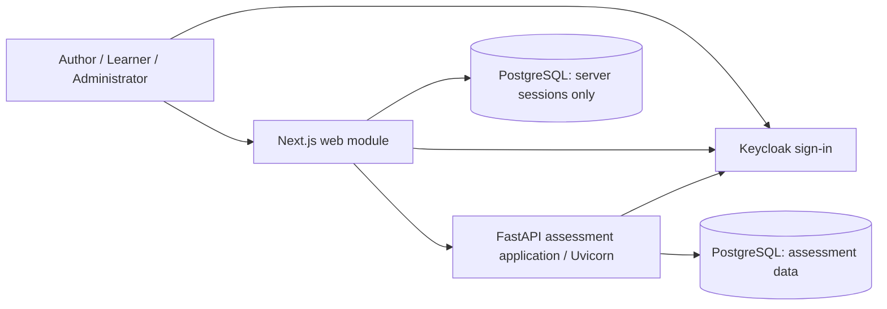
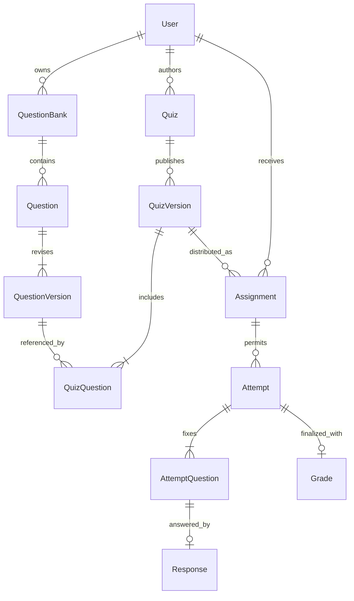
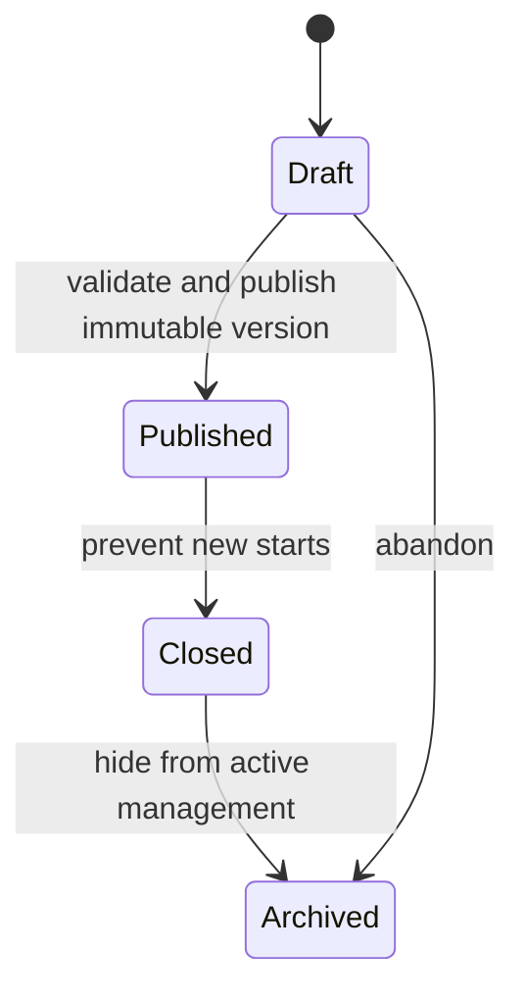
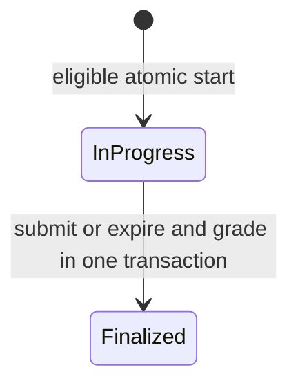

# Prototype high-level architecture

**Date:** 20 October 2026  
**Status:** F01/F02/F03/I01 integrated; I02 real-browser proof and minimal integration fixes active.

**Product baseline:** [PRD v0.1](reference/02-Product-Requirements.md), as scoped by
[Prototype scope](PROTOTYPE-SCOPE.md).

## 1. Drivers and constraints

The confirmed goal is one organization's low-stakes P0 assessment lifecycle.
Correct historical results, durable saved answers, server-enforced policy,
retry-safe submission, accessible UX, and low operational complexity drive this
design (PRD sections 6-7, 10-11). A convenient demo must not bypass these invariants.

Quezo uses Next.js/React for the frontend and Python/FastAPI for the backend,
with PostgreSQL, Keycloak and Docker. On 20 October 2026 the user confirmed that
backend maintainers are comfortable with Python and accept a two-language stack.
Media, community, subscription and proctoring capabilities are outside the
prototype's assessment scope. No reference project code is copied, and competitor
claims are not treated as independently validated evidence.

## 2. Technology stack

| Area | Quezo proposal / scaffold |
| --- | --- |
| Web | Next.js 16.4.2 App Router, React 19.3.1, TypeScript 5.9.3 |
| Application backend | Python 3.12+, FastAPI 0.156.1, Pydantic 2.14.1 and Uvicorn 0.54.0; separate ASGI backend process |
| Persistence | PostgreSQL 17 local image; Psycopg async pool/transactions and Alembic foundation migrations integrated; no domain tables yet |
| Identity | Keycloak 26.4.7 local-development image; web code + PKCE and independent backend JWT validation implemented; combined browser gate remains I02 |
| Packaging | Docker and environment configuration; local dependency Compose file now; production application images/pipeline after review |
| Automation | npm for the frontend; uv 0.12.17 and `pyproject.toml` for the backend; root npm convenience wrappers work on Windows/Linux |
| Backend checks | Strict mypy and pytest with FastAPI's test client; Python dependencies locked separately |
| Search | Text/category/tag search first; PostgreSQL `pg_trgm` is available as a future migration if measured search needs justify it; no external search engine |

Node.js 22+ is required for Next.js development/builds and server-side execution.
Frontend dependencies are pinned in npm manifests and `package-lock.json`; backend
dependencies are pinned in `postgres/pyproject.toml` and `postgres/uv.lock`.
`postgres/.python-version` selects Python 3.12 for reproducible local defaults.
Container image tags are development defaults, not immutable production digests.
Under [G00/DEC-07](SOFTWARE-SPECIFICATION.md#g00-approval-record-20-october-2026),
B.C. approved Psycopg 3 async/pooling and Alembic with SQLAlchemy Core (no ORM)
for F01, plus openapi-typescript and openapi-fetch for F02 on 20 October 2026.
These dependencies are now locked and integrated. The
[second-wave approval](SOFTWARE-SPECIFICATION.md#second-wave-approval-f03-and-i01)
selects openid-client and node-postgres (`pg`) for web OIDC/restricted PostgreSQL
sessions, and PyJWT with cryptography plus HTTPX for backend JWT/JWKS validation.
Second-wave libraries are now locked and integrated. No UI kit is selected.
Use parameterized access and reviewed, ordered migrations. The
backend keeps the existing `postgres/` directory name but is no longer an npm
workspace; its importable Python application lives in `postgres/src/quezo_api/`.

## 3. System context and runtime shape

This is a **modular monolith** on the backend plus a web presentation process,
not a set of independently deployed domain microservices. The two PostgreSQL
boxes denote restricted responsibilities in one application database, not two
required database instances. Keycloak owns its own identity persistence.

Proposed production traffic is same-origin HTTPS. Next.js acts as a thin
server-side session facade: browser credentials/tokens do not enter JavaScript
storage, and business rules live only in FastAPI. It forwards access tokens to
FastAPI, which independently validates issuer, audience, signature, expiry,
roles, application access status, and resource ownership. Next.js must not become
a second assessment implementation.

Only Next.js may access its session records; it must not read assessment tables
directly. FastAPI owns assessment persistence and must not read session secrets.
Production database privileges should enforce this separation.

**Current foundations:** PostgreSQL pool/transaction/migration infrastructure,
generated OpenAPI/TypeScript contracts, F03 OIDC/server sessions/navigation and
I01 independent token validation/current-actor `/me`. I02 must prove the combined
real-browser flow and resolve EX-I02-01, the native-form Origin finding. No
assessment persistence/workflows exist; shared documentation exposure remains
a deployment decision.

## 4. Module responsibilities and interfaces

| Module | Small external interface (conceptual, not frozen method names) | Hidden implementation / responsibility |
| --- | --- | --- |
| Identity and access | Resolve actor; administer access; authorize operation | Keycloak claims/admin adapter, local account status, role and ownership checks |
| Question authoring | Manage/search questions; obtain a specified revision | Bank ownership, tags/category, validation, archive rules, immutable revisions |
| Quiz publication | Edit/preview draft; publish/close/archive quiz | Composition, points, schedule, publication validation, immutable version creation |
| Distribution | Assign learner; check eligibility | Assignment ownership, active account, schedule and attempt allowance |
| Assessment execution | Start/resume; save response; finalize | Snapshots, stable order, deadline, revision conflicts, locks, transaction and retry semantics |
| Scoring | Calculate objective grade from fixed attempt inputs | Correctness, unanswered items, points arithmetic; pure calculation inside finalization |
| Results | Read permitted result/history/summary/submission | Author ownership, learner identity, policy-based redaction and aggregation |

Modules live inside `postgres/src/quezo_api/modules/` as they are implemented. Their
interfaces are also their test surfaces. HTTP routing translates requests and
errors; it does not implement grading, deadlines, or authorization separately.
Do not pre-create layers of generic repositories or pass-through wrappers.
Introduce an adapter seam where behavior actually varies (for example Keycloak
versus a controlled test identity provider), not for every database query.

The source glossary is [CONTEXT.md](../CONTEXT.md). Database schema, HTTP DTOs,
and browser presentation models are not automatically interchangeable.

Use typed Python interfaces and Pydantic request/response models at HTTP seams;
validation does not replace authorization, database constraints, or state-machine
checks. Async routes must use nonblocking database/network libraries. Keep
blocking work outside the event loop, and size database connection pools across
all Uvicorn workers. Adding workers is not a substitute for transaction correctness.

## 5. Proposed data model

This is a conceptual design, not a migration or a committed physical schema
(PRD section 8, FR-014, FR-018, FR-042, FR-062).

| Record | Proposed persistence rules |
| --- | --- |
| User | Stable application UUID; unique `(issuer, subject)` identity mapping; active status and application roles; no application password storage |
| QuestionBank / Question | Author ownership; one bank per question initially; stable identity independent of revisions; archive rather than deleting referenced content |
| QuestionVersion | Immutable prompt, stable option IDs, correct option, default points, feedback, category/tags; existing versions remain reachable |
| Quiz / QuizVersion / QuizQuestion | Editable draft separate from immutable published version; fixed question-version references and point overrides; unique positions within a version |
| Assignment | Exactly one named learner and published quiz version; unique pair initially; attempt limit belongs to the pinned policy, not a mutable UI value |
| Attempt | Assignment and learner; immutable quiz-version reference; attempt number; start/deadline/finalization timestamps and reason; result policy pinned at start |
| AttemptQuestion | Fixed content, option IDs/order, points and private scoring definition; unique position per attempt; never serialize private keys into ordinary learner views |
| Response | At most one current response per attempt question; selected option ID or explicit empty answer; integer revision and persisted timestamp |
| Grade | At most one grade per attempt; objective totals and per-question outcomes; committed atomically with finalization |
| AuditEvent | Minimal actor/action/resource/time/request-ID records for publication, access changes and finalization; no tokens or raw answer content |

Use foreign keys, uniqueness, nonnegative point constraints, UTC timestamps, and
indexes on ownership, assignment/learner, attempt state/deadline and reporting
paths. Store the selected IANA time-zone name alongside normalized availability
instants to explain schedules. Resolve ambiguous daylight-saving inputs in the
author UI rather than guessing.

Proposed scoring uses nonnegative integer points, no partial credit or penalties,
and requires a positive quiz total. An incorrect or unanswered response earns
zero but has a different outcome code. Percentages are display calculations;
earned and possible integer totals remain authoritative. Fractional points are a
review decision, not an accidental floating-point implementation.

There is no Organization, Membership or Group schema in the initial prototype.
Single-organization does not remove per-author ownership or per-learner privacy.
Adding tenancy later requires an explicit ownership/isolation migration, not an
unscoped optional `organizationId` bolted onto requests.

## 6. Publication, attempts and release policies

### Publication

Proposed rules: edits after publication create a new draft revision; publishing
it creates another immutable version. Existing assignments and attempts stay
pinned. Assignments for a new version are explicit. No in-place edit, reopening,
or physical deletion changes historical attempts.

Closing stops new starts but does not shorten an already-started attempt's
deadline. Archiving requires no remaining active attempts and never deletes
results. Closing is not the same event as the configured availability deadline
and does not automatically release answers.

### Attempt lifecycle

Separate **completion reason** (`submitted` or `expired`) from **grade state**.
For objective-only P0 attempts, a committed finalized attempt always has its
final grade; there is no exposed intermediate "submitted but ungraded" state.
No retry or administrative action reopens it. Future manual grading requires
a reviewed state-machine extension, not invented pending grades in the prototype.

Proposed attempt accounting: a successful start consumes an allowance, expired
attempts count, only one in-progress attempt exists per assignment, and concurrent
start requests resume that attempt rather than consume another allowance.
Finalized retries return the same result, not a new attempt.

### Time and result release

The server computes `deadlineAt` as the earlier of availability end and
start time plus the configured duration, ignoring absent bounds. Start is allowed
at or after availability start and strictly before availability end; answer saves
and voluntary submit must be admitted strictly before the attempt deadline.
At or after the deadline, finalization is expiration and uses only accepted saves.
Client timestamps cannot extend time. Unlimited duration/attempt count is an
explicit author option, not an invalid value silently treated as unlimited.

Proposed independent release modes for score, correct answers and explanations
are: after finalization, after the scheduled availability end, or never.
"After availability end" requires an end time. Release is evaluated by the server
on every result read against the pinned policy. Before release, omit restricted
fields entirely. Authors can inspect only their own quizzes' submissions;
administration privilege does not automatically imply permission to read answers.

**Review examples:** Does a learner started at 09:59 get cut off at a 10:00
availability end despite a 20-minute duration? This proposal says yes. Does an
author closing a quiz at 09:58 terminate existing attempts? This proposal says
no. Editing the original question or publishing a new version never changes
either learner's content, grade, or release policy. Approve these distinctions
before implementing them.

## 7. Durable save and finalization protocol

These rules implement FR-031-038 and NFR-004-005. They require real PostgreSQL
transaction tests, not just mocked HTTP success.

**Start:** In one transaction, lock the assignment, recheck account eligibility,
publication/schedule and allowance, resume an existing active attempt if present,
or allocate one attempt number and persist the full question/option order and
private scoring snapshot. Database uniqueness backs up application checks.
Randomization occurs once, not on every fetch.

**Save:** The learner sends an option ID (or explicit cleared response), an
expected response revision, and a unique request ID. The server authenticates,
locks the parent attempt first, checks state/deadline using authoritative time
after obtaining the lock, and validates the option against the attempt snapshot.
It then applies a compare-and-swap response update and durably records the request
ID, payload fingerprint, and acknowledgement in the same transaction. A repeated
ID with the same payload returns its original acknowledgement; reuse with another
payload is a conflict. A stale revision returns the current revision without
overwriting it. The request ledger is scoped to actor/attempt and retained at
least through the retry window, which must be defined before cleanup is enabled.

Success is returned only after commit. The client marks only the acknowledged
local revision as saved; a newer edit remains unsaved. It serializes saves for a
question, does not silently last-write-win across tabs, and reconciles server
state on resume. Unsaved offline edits may be retained in memory with a warning,
but offline durable storage and accepting late offline answers are not promised.

**Submit:** The client first waits for its outstanding saves and reports any
failure/conflict; submit is not an alternative endpoint for unacknowledged answers.
In a transaction, lock the same parent attempt, return the stored outcome if
already finalized, otherwise check authoritative time, grade persisted responses,
insert its unique Grade and record finalization/audit metadata atomically.
Validation errors roll back. A lost HTTP response after commit is safe to retry.
Use a consistent lock order across save/start/finalize paths and bounded retry
handling for database serialization/deadlock failures.

**Expire:** A lifecycle-managed periodic task in the FastAPI process claims overdue attempts with
PostgreSQL locks (bounded batches, `SKIP LOCKED`) and calls the same finalization
logic. Relevant reads/writes also reconcile overdue attempts, so a stalled task
cannot extend eligibility or accept late answers. On restart the task catches up.
Multiple future backend instances may race safely; no Redis or message broker is
required. FastAPI's per-response `BackgroundTasks` is not a durable scheduler;
register the periodic task with application lifespan and shut it down cleanly.
The task is planned, not running in the scaffold.

**Durability scope:** PostgreSQL committed writes with durable settings are the
authority, not browser state or memory. Failure scenarios include response loss,
client refresh/disconnect, application crash/restart, and concurrent requests.
A single local Docker volume is not a guarantee against host/disk loss. Backup
RPO and disaster recovery require explicit approval before a pilot.

## 8. Application contracts and errors

Proposed `/api/v1` resources:

| Resource group | Operations | Principal checks |
| --- | --- | --- |
| `/users` | Basic account/role/access administration | Administrator; validate allowed roles; auditable changes |
| `/questions`, `/question-banks` | CRUD/archive/search, revision access | Author ownership; no unrestricted answer-key discovery |
| `/quizzes` | Draft composition, preview, publish/close/archive | Author ownership and valid state |
| `/assignments` | Assign named learner; list eligible quizzes | Owning author for assignment; learner sees only own eligibility |
| `/assignments/{id}/attempts` | Start or resume an attempt | Named learner, schedule, allowance, atomic start |
| `/attempts/{id}/responses/{questionId}` | Read permitted view; save a response | Attempt owner, editable state, deadline, expected revision |
| `/attempts/{id}/submission` | Finalize saved answers | Attempt owner, replay-safe finalization |
| `/attempts/{id}/result`, `/me/attempts`, `/quizzes/{id}/results` | Policy-filtered result, history and author report | Ownership and release checks before serialization |

These are design sketches, not implemented endpoints. Define typed Pydantic
request/response models with each approved slice; FastAPI generates the OpenAPI
contract. F02 generates types with openapi-typescript and uses openapi-fetch
for the typed client, rather than manually duplicating Python types, and checks
contract/client drift in CI. I01 implements /api/v1/me alongside liveness;
the assessment routes above remain future work. Stable internal contracts and local
interactive documentation do not constitute the P1 supported external API.

Use structured errors such as `{ code, message, requestId, details? }`, with safe
field-level validation details. Distinguish unauthenticated (401), forbidden (403),
missing or deliberately concealed resources (404), invalid state/revision (409),
invalid payload (422), rate limits (429), and dependency failure (503).
Deadline conflicts return authoritative attempt status and server time.
Do not echo secrets, scoring keys, database errors or another learner's work.
Writes do not return success-shaped fallback responses when a dependency fails.
F02 implements sanitized exception/validation handlers before business routes,
without echoing sensitive request values. Future domain error details still
require explicit disclosure-reviewed schemas.

## 9. Security and privacy

Keycloak owns credentials, login, reset and identity lifecycle. Proposed login
uses authorization code + PKCE, validated state/nonce and exact redirect URIs.
Store tokens only in server-side sessions, with Secure/HttpOnly/SameSite cookies,
expiry and rotation. State-changing browser requests require CSRF protection and
origin checking; tokens and sessions must not be embedded in HTML or localStorage.
The chosen session library and revocation approach need an implementation review.

Application account status is checked on assessment operations; disabling access
must not depend solely on waiting for an already-issued token to expire. Claims
alone cannot authorize another author's content or another learner's attempt.
The Keycloak admin adapter uses least privilege; secrets never reach the browser.

Restrict local dependency ports to loopback. Use TLS, a secret store, hardened
Keycloak deployment and limited database credentials for any shared environment.
Validate all inputs and size limits; rate-limit auth, attempt start, and writes;
use parameterized SQL. Prefer plain text content in the first prototype rather
than rendering untrusted author HTML. Keep protected responses uncached/private;
never let framework or proxy caching share answers, sessions or results.

Collect identity subject, display name and only necessary contact information.
Do not log passwords, tokens, cookies, answer content or answer keys. Define
retention, deletion/export procedures and access to assessment records before
using real learner data. No consent, regulatory or tenancy compliance is implied.
No `AUTH_DISABLED` bypass is included; assessment operations must require
authentication and authorization.

## 10. Reliability, observability and verification plan

| Concern | Planned evidence |
| --- | --- |
| Version integrity | Editing questions/published drafts never changes snapshots or previous grades |
| Concurrency | Parallel starts respect limits; stale and duplicate saves behave explicitly; concurrent saves/submits/expiry yield one result |
| Time | Server-clock tests around exact deadlines, schedule time zones and daylight-saving ambiguity |
| Disclosure and access | Negative checks for every role, owner and result-release mode; inspect payloads, not only hidden UI |
| Scoring | Pure tests for MCQ/true-false, unanswered versus wrong, point overrides and totals |
| Recovery | Commit/response-loss, restart and disconnect tests against real PostgreSQL; isolated backup restoration with recorded recovery time/data loss |
| UX/accessibility | Keyboard and screen-reader flows; labels, focus, visible save/error state, accessible timer notices and responsive layouts |
| Load | Proposed baseline below; record latency distributions, error rate, resource and connection use |

Candidate load profile for approval: 100 active learners, 20 questions per quiz,
up to four options and 2 KB prompt text each, changed-answer saves at most every
five seconds per learner (roughly 20 writes/second steady state), and a burst of
100 submissions within five seconds. Include 10,000 historical attempts and
document hardware, database connections, network/device profile and ramp-up.
Measure the PRD's <=300 ms p95 read and <=2.5 s p75 usable UI targets separately;
neither is established by this scaffold. Do not interpret 99.5% availability as a
commitment until hosting and monitoring are agreed.

Planned operational signals: request correlation and structured error logs,
save/finalization failures and latency, overdue-attempt backlog, connection pool
pressure, and result-policy denials without sensitive payloads. `/health/live`
only proves the process can answer; a separate future readiness check must verify
database/schema and required identity configuration without exposing secrets.
No readiness claim should be inferred from the scaffold's liveness endpoint.

## 11. Deployment and evolution

Today: npm runs the Next.js shell; uv manages the Python environment and Uvicorn
runs the FastAPI shell. Root npm scripts are convenience wrappers only; backend
development also works with uv alone. Optional Compose dependencies
provide PostgreSQL with a named volume and Keycloak in `start-dev` mode with local
file persistence. Keycloak's development storage is explicitly not its production
database design. No realm, client, users, tables or migrations are provisioned.

After approval: build separate web/backend Docker images; run ordered migrations
once as a release step with a restricted migration identity, not independently
from every application replica. Use reviewed forward migrations, verify backup
before destructive changes, and define a recovery/rollback procedure. Keycloak
uses its own production PostgreSQL database/credentials, not assessment tables.

CI checks the frontend on Node.js 22/24 and the backend on Python 3.12/3.14 in
separate jobs. npm uses `npm ci`; uv uses `uv sync --locked`. Frontend checks cover
types and the Next.js build; backend checks use strict mypy and pytest. Python
does not need the former TypeScript compilation or `postgres/dist/` artifacts.
Add real-database integration tests, contract checks and browser journeys as
features land. Production deployment, data seeding and migrations are deliberately
absent from this scaffold's CI.

Proposed environments are local development, a synthetic-data review environment,
then a pilot only after approval of hosting, privacy, load, backup RPO/RTO and
accessibility expectations. Read replicas, caching, queues and horizontal scale
are evidence-driven later changes. Keep transactions and server-side session
storage compatible with additional application instances, without deploying them
preemptively.

## 12. Trade-offs and review status

| Choice | Rationale / alternative | Status |
| --- | --- | --- |
| FastAPI modular monolith plus Next.js web | Maintainers are comfortable with Python; Pydantic/OpenAPI reduce contract boilerplate. Accepts separate Python and TypeScript toolchains while keeping one home for domain rules | Stack confirmed 20 October 2026; detailed layout proposed |
| Immutable published versions plus attempt snapshots | Extra storage for historically correct content and reproducible randomized delivery; mutable live question references rejected | Required invariant; physical representation proposed |
| Synchronous objective finalization transaction | One committed outcome instead of a queue and transient ungraded state; bounded objective workload supports this | Proposed |
| Server-side session facade | Keeps tokens out of browser storage; adds session storage and CSRF work versus a browser-token client | Implemented; I02 must close EX-I02-01 and combined browser acceptance |
| One organization, per-owner access | Reduces first prototype complexity without pretending tenant isolation already exists | Scope confirmed |
| No auth bypass or speculative infrastructure | A shell is enough before review; avoids unsafe demo behavior and unneeded distributed dependencies | Scaffold decision |

Review the [I02 assignment and explicit exception](SOFTWARE-SPECIFICATION.md#i02-assignment-and-completion-exception)
before feature work. The software specification records approved behavior,
contracts and acceptance cases; dependency-aware packages,
parallel workstreams and tracking live in the
[implementation bundle](implementation/README.md). F01/F02/F03/I01 are done
with the explicit F03 browser exception carried into active I02 work. Later
operational/pilot decisions remain held. Foundation/identity migrations and
OpenAPI exports exist; assessment schemas and UI arrive with assigned slices.
