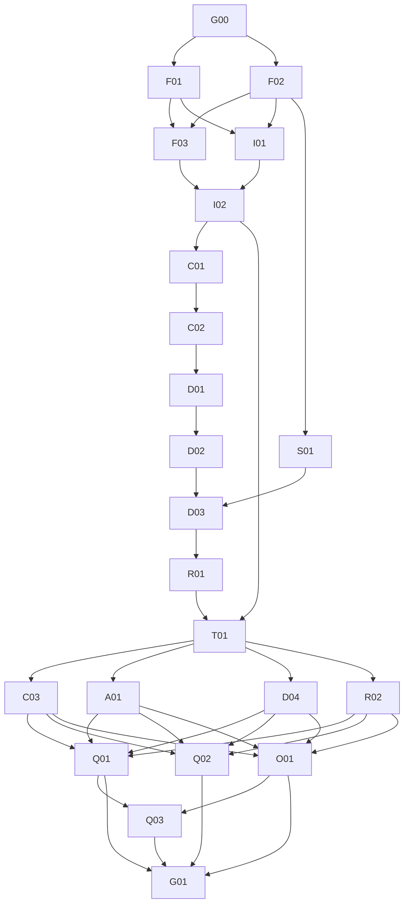

# Phased implementation plan

**Date:** 23 October 2026

**Status:** Working foundations including I02 accepted; EX-I02-01 closed.
C01/C02/D01/D02/S01/D03/R01 accepted and integrated; T01 active with its
producer gate satisfied. Milestone acceptance remains B.C.'s review decision.

## 1. Start here

The [software specification](../SOFTWARE-SPECIFICATION.md) defines behavior and
acceptance IDs; the [HLA](../PROTOTYPE-HIGH-LEVEL-ARCHITECTURE.md) defines architecture;
the [scope](../PROTOTYPE-SCOPE.md) defines inclusion/exclusion. This bundle turns
those into individually assignable work packages.

**Current checkpoint, 23 October 2026:** B.C. confirmed I02 completion; merged
PR #7 (`553a2c8`) and browser/CI evidence support acceptance and EX-I02-01 closure.
B.C. assigned C01, C02, D01, D02, S01, D03, R01 and T01 as `active`, explicitly
retaining their dependency execution gates. Those seven T01 producers are now
accepted and integrated, through R01 PR #14 merge `8976371`; B.C. directed
T01 execution after acceptance reconciliation. Exact commits and evidence live
in the [backlog](BACKLOG.md). No Phase 3 dispatch is authorized. Use the
[eight copy-ready prompts](PHASE-2-HANDOFFS.md) and
[Phase 2 approval/defaults](../SOFTWARE-SPECIFICATION.md#phase-2-assignment-and-demo-defaults).
B.C. owns every package's integration/review/merge. No agents were launched.
DEC-08/09/10 and later DEC-11 commitments remain held.

1. Review **G00** and approve the decisions needed for the first development wave.
2. Assign a human integration owner and update the [backlog](BACKLOG.md).
3. Assign work using the [agent handoff](AGENT-HANDOFF.md); begin implementation
   only when its execution gate is satisfied.
4. Merge tested producer interfaces before completing their consumers.
5. Demonstrate each milestone; record evidence in the backlog before releasing
   more work. A phase label does not itself authorize deployment or real data.

The existing scaffold is the starting point, not completion of a foundation or
assessment work item. No issues, PRs, child sessions, coding agents or external
resources are created by this plan.

## 2. Phases and exit gates

Phase numbers are delivery milestones, not additional hidden dependencies.
[BACKLOG.md](BACKLOG.md) is the authoritative dependency list. An independent
item may start early when its prerequisites and decisions are satisfied and
someone explicitly assigns it; for example S01 can run alongside identity work.

| Phase | Packages | Demonstrable outcome / exit gate |
| --- | --- | --- |
| 0. Baseline approval | G00 | DEC-01 through DEC-07 agreed or affected items explicitly held; named reviewers, assigned owners and approved synthetic-data wave |
| 1. Working foundations | F01, F02, F03, I01, I02 | Real database migration path, stable contract/error conventions, Keycloak-backed sign-in, server-side web session and backend authorization exercised together |
| 2. First complete lifecycle | C01, C02, D01, D02, S01, D03, R01, T01 | Author creates/reuses a question, publishes and assigns a quiz; learner saves/resumes, finalizes once and sees permitted results in a real browser |
| 3. Full P0 workflow | C03, A01, D04, R02 | Complete author/admin controls, scheduling/randomization/limits, history and author reporting; all P0 features wired, not just backend routes |
| 4. Hardening and operations | Q01, Q02, O01, Q03 | Integrity/security failure evidence, accessible flows, reproducible deployment/restore, and measured load/multi-process behavior |
| 5. Prototype acceptance | G01 | Complete traceability, reviewed evidence and explicit acceptance or named blockers; pilot remains gated separately |

Detailed packages are grouped by what an assignee needs to read:

- [Foundation packages](01-FOUNDATIONS.md): G00 and identity/platform work.
- [Core lifecycle packages](02-CORE-LIFECYCLE.md): the first end-to-end assessment.
- [P0 completion packages](03-COMPLETE-P0.md): parallel feature-completion tracks.
- [Readiness packages](04-READINESS.md): hardening, operations and final acceptance.

## 3. Dependency and parallelism view

Safe opportunities, subject to assignment and file ownership:

| Ready point | Concurrent work | Why it is separable |
| --- | --- | --- |
| G00 accepted | F01 database foundation + F02 contracts | Persistence setup and HTTP/schema tooling have distinct initial surfaces |
| F01 + F02 merged | F03 web/session shell + I01 identity backend; S01 grading can also start | Session presentation, identity integration and pure grading are separate modules |
| T01 accepted | C03 author workflow + A01 administration + D04 policy controls + R02 reporting | Distinct feature responsibilities, with shared quiz integration explicitly serialized |
| Phase 3 packages merged | Q01 failure/security evidence + Q02 accessibility + O01 operations | Test/integrity work, UX review and deployment artifacts can advance independently |
| O01 + Q01 complete | Q03 load/multi-process evidence while remaining Q02 review finishes | Load has a reproducible target and established correctness baseline |

The lifecycle spine from question -> publication -> assignment -> save ->
finalization -> result is intentionally dependency-ordered. Splitting that spine
into disconnected agents before contracts exist would manufacture integration
work, not shorten delivery. No fixed duration, staffing level or delivery date is
claimed; estimate packages after G00 and recalibrate after T01.

## 4. Integration and ownership rules

One agent/session owns one package in an isolated worktree. Use a fresh branch
from the integrated baseline unless a dependent stack is explicitly coordinated.
Independent packages can merge in either order once their own prerequisites are
merged; dependent consumers rebase/update to the actual producer result.

An integration owner coordinates these shared surfaces:

| Shared surface | Rule |
| --- | --- |
| Dependency manifests/lockfiles, root scripts, CI, Compose | One assigned writer at a time; request narrowly scoped additions and regenerate locks with the package manager |
| Database migrations | Domain owner supplies migration with its feature; integration owner serializes revision ordering before merge, verifies clean upgrade and upgrade from the previous baseline |
| FastAPI app/router registration | Domain routers stay local; integration owner resolves registration/lifespan changes without duplicate initialization |
| OpenAPI export/generated TypeScript client | Server models are authoritative; regenerate after producer merges; no hand-editing generated output |
| Root web layout/session facade/shared navigation | Web foundation owner or designated integrator changes these; feature owners work in their route subtree |
| Quiz editor route and quiz-module assembly | C03 owns composition/lifecycle, D04 owns policy settings; agree file seams before concurrent work and serialize their shared route/assembly edits |
| Shared test fixtures and tracker | Integrator maintains common fixtures and merges evidence/status updates; package tests live in feature-specific files |

Within a feature, prefer a vertical slice: migration + backend + UI + tests.
Use schemas and validated fixtures for early UI work only after the producer
shape is agreed. Fixture work remains incomplete until wired to real auth,
persistence and endpoints. Contract changes affecting another package require
an explicit updated dependency/handoff before that consumer continues.

## 5. Definition of ready and done

**Assignment versus execution:** B.C. may explicitly assign a whole wave as
`active` before all producers finish. Such a row is assigned, not automatically
executable. Its handoff must name the unmet prerequisites; only planning and
contract reading may proceed until those producers are accepted and integrated.
This does not alter the dependency graph or permit fixture-only substitutes for
unfinished producer implementations.

**Ready to implement:** specification references understood; required decisions approved;
all backlog prerequisites are done and integrated; input schemas are available;
owner and permitted file surfaces assigned; acceptance evidence is named.

**Done:** every package acceptance condition is met; current type/build checks
and relevant new tests pass; real persistence/auth/browser behavior is verified
where required; migrations work cleanly and from the prior baseline; contract
changes and setup instructions are current; review accepted and changes integrated.
The tracker records the commit/PR and evidence. "Agent finished", "code exists",
"mock passes", and "PR opened" are not done.

A newly found bug belongs to the affected package or a new linked item; it is not
silently deferred past an integrity/authorization gate. Split an oversized package
before execution using stable child IDs and explicit dependencies in the backlog;
preserve its acceptance coverage and mark the parent done only when all children
are integrated. Do not create arbitrary parallel subtasks that edit the same files.

## 6. Approval and pilot boundaries

G00 authorizes only explicitly selected development work. DEC-08 is needed before
turning proposed performance numbers into gates; DEC-09 is needed before completing
timed UX; DEC-10 is needed before real learner data or a shared pilot. G01 records
actual results and unresolved decisions, not an inferred launch approval.

The prototype may be accepted as a synthetic-data demonstration while pilot
readiness remains blocked. Any accepted exception must name its owner, impact,
scope and follow-up; integrity or unauthorized disclosure failures are blockers,
not cosmetic exceptions.
